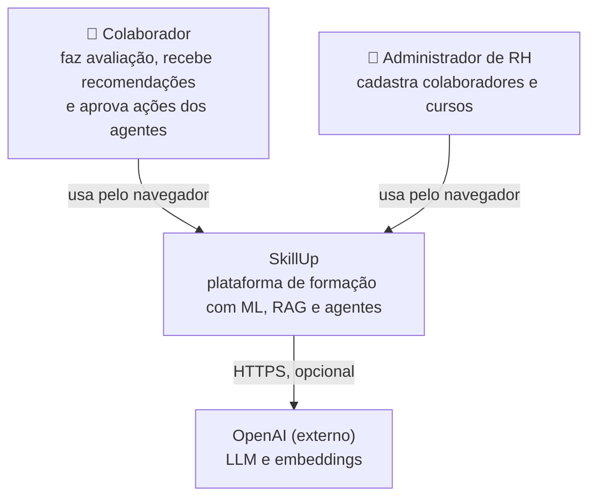
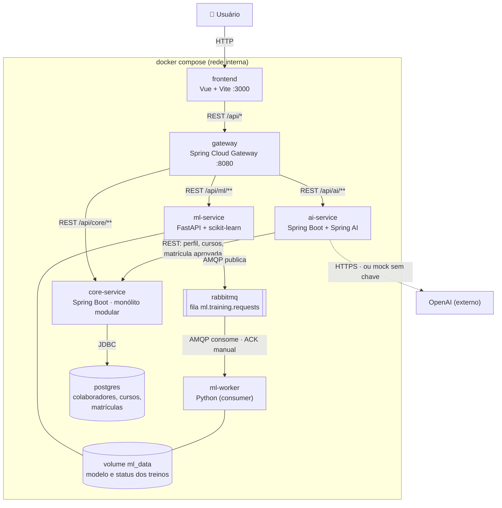
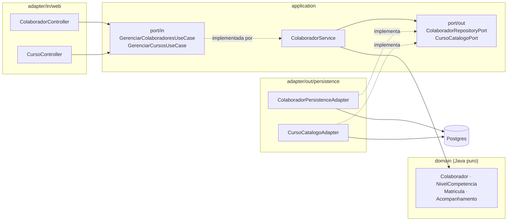
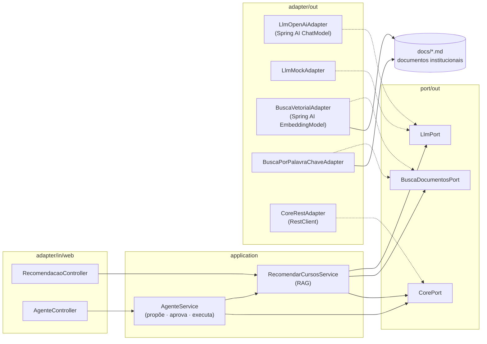

# SkillUp

Plataforma de formação de colaboradores com avaliação de competências por Machine Learning, recomendação de cursos com RAG e agentes de IA que só agem com autorização do usuário.

Trabalho da AF de **DevOps e QA** (Facens), baseado no Estudo de Caso 1 do documento `AF_Facens_v2.pdf`.

| Integrante | RA | Requisitos |
| --- | --- | --- |
| Gustavo (tech lead) | _preencher_ | RF01, RNF04 |
| Lucas | _preencher_ | RF02, RF05 |
| Gabriel | _preencher_ | RF03, RF04 |

---

## Como rodar

Pré-requisito: Docker Desktop aberto.

```bash
docker compose up --build
```

| O quê | Endereço |
| --- | --- |
| Aplicação (front) | http://localhost:3000 |
| API Gateway | http://localhost:8088 |
| Painel do RabbitMQ | http://localhost:15672 (usuário `guest`, senha `guest`) |

A primeira subida demora alguns minutos porque o Docker baixa as dependências do Maven, do npm e do pip.

**IA real (opcional):** copie `.env.example` para `.env` e preencha `OPENAI_API_KEY`. Sem a chave, o `ai-service` sobe normalmente e usa adapters mock (busca por palavra-chave e recomendação por regras). A tela mostra qual modo respondeu.

---

## Problema

Uma empresa de educação corporativa quer que seus colaboradores façam avaliações de competência, recebam recomendações personalizadas de cursos e acompanhem sua evolução. A equipe de desenvolvimento é pequena e precisa evitar complexidade operacional, mas espera crescimento de usuários e quer evoluir os componentes de IA de forma independente.

### Requisitos implementados

| ID | Requisito | Onde está | Responsável |
| --- | --- | --- | --- |
| RF01 | Cadastro e consulta de colaboradores e cursos | `core-service`, módulo `colaboradores` | Gustavo |
| RF02 | Classificar o nível de competência com ML | `ml-service` (`POST /predict`) | Lucas |
| RF03 | Recomendar cursos com RAG sobre documentos institucionais | `ai-service` (`RecomendarCursosService`) | Gabriel |
| RF04 | Agentes de IA coordenam orientação e acompanhamento com autorização do usuário | `ai-service` (`AgenteService`) | Gabriel |
| RF05 | Acompanhar o andamento dos treinamentos do modelo | `ml-service` + `ml-worker` + RabbitMQ | Lucas |
| RNF02 | Aceitar pedidos de treino com o ML indisponível | Fila durável `ml.training.requests` | Lucas |
| RNF03 | Proteger dados pessoais e controlar o acesso dos agentes | E-mail mascarado no core, agentes sem acesso a e-mail, ferramentas por agente | Gabriel e Gustavo |
| RNF04 | Evoluir a IA sem comprometer cadastro e consulta | Serviços de IA e ML separados atrás do gateway | Gustavo |

---

## Arquitetura C4

### Nível 1: Contexto



### Nível 2: Contêineres



**Limites de implantação:** tudo dentro do retângulo sobe com um único `docker compose up --build`. A OpenAI é o único sistema externo e é opcional.

### Nível 3: Componentes do core-service (módulo `colaboradores`, hexagonal)



Os módulos antigos `ranking` e `conquistas` (da AC1) continuam no mesmo deploy. O teste `ArquiteturaModularTest` garante que um módulo não acessa o `internal` de outro.

### Nível 3: Componentes do ai-service (hexagonal)



A classe `IaConfig` escolhe os adapters: com `OPENAI_API_KEY` usa OpenAI, sem chave usa os mocks. O restante do código não muda.

---

## Microsserviços e gateway

A solução é **híbrida** (ADR-001 abaixo):

- O **negócio** (cadastro, consulta, matrículas, ranking da AC1) fica em um **monólito modular**, o `core-service`. Um deploy só, um banco só, o que é barato para uma equipe pequena (RNF05).
- **IA** (`ai-service`) e **ML** (`ml-service` + `ml-worker`) são **serviços independentes**, com build, linguagem e ciclo de deploy próprios. Se a IA cair ou for reescrita, o cadastro continua funcionando (RNF04).
- O **API Gateway** (Spring Cloud Gateway) é a **porta única de entrada**. O front só conhece o gateway (`localhost:8088/api`). O gateway roteia por prefixo e reescreve o caminho:

| Rota no gateway | Destino |
| --- | --- |
| `/api/core/**` | `core-service:8080/api/**` |
| `/api/ai/**` | `ai-service:8082/**` |
| `/api/ml/**` | `ml-service:8000/**` |

Assim os serviços internos não ficam expostos e endereços, timeouts e cabeçalhos ficam centralizados num lugar só (`gateway/src/main/resources/application.yml`).

## Arquitetura hexagonal

`core-service/colaboradores` e `ai-service` seguem **ports and adapters**:

- **domain:** regras puras, sem Spring nem JPA. Exemplos: `Colaborador.novo()` valida o e-mail, `emailMascarado()` protege o dado pessoal e `Agente.podeUsar()` controla as ferramentas.
- **application:** casos de uso que conversam só com **portas** (interfaces).
- **adapters:** o que fala com o mundo, como controllers REST, JPA, RestClient, OpenAI e mock.

O fallback de IA é a prova prática: trocar OpenAI por mock é só ligar outro adapter na mesma porta.

## Comunicação síncrona e assíncrona

| Interação | Tipo | Justificativa |
| --- | --- | --- |
| Front → gateway → core (cadastro e consulta) | REST síncrono | O usuário espera a resposta na tela |
| Front → gateway → ml-service `/predict` | REST síncrono | Inferência leva poucos milissegundos, e o RNF01 pede resposta em até 2 s |
| Front → gateway → ai-service (recomendação e agentes) | REST síncrono | O usuário espera a recomendação. O ai-service chama a OpenAI e o core também por REST |
| ml-service → RabbitMQ → ml-worker (treino) | **Assíncrono (AMQP)** | Treinar é demorado. A API responde **202** na hora e a fila durável guarda o pedido mesmo com o worker fora do ar (RNF02). O ACK manual garante reentrega se o worker cair no meio |

Detalhes do RabbitMQ: exchange padrão (`""`, tipo direct), routing key `ml.training.requests` (igual ao nome da fila), mensagens persistentes (`delivery_mode=2`), `prefetch_count=1` e ACK manual depois de gravar o resultado. O worker também publica o resultado em `ml.training.results`. O status de cada treino fica em `/data/jobs/<id>.json` (volume compartilhado) e o front consulta a cada 2 s.

---

## ADR-001: Arquitetura híbrida (monólito modular + serviços de IA)

- **Contexto:** a equipe é pequena e quer pouca complexidade operacional (RNF05), mas os componentes de IA mudam rápido, usam Python e não podem derrubar o cadastro (RNF04). O treino de ML pode ficar indisponível (RNF02).
- **Decisão:** manter o negócio num monólito modular (`core-service`) e separar IA (`ai-service`) e ML (`ml-service` + `ml-worker`) em serviços próprios, todos atrás de um API Gateway. A integração é por REST quando há resposta imediata e por RabbitMQ no treino.
- **Justificativa:** concentra o que muda pouco num deploy simples e isola o que muda muito ou usa outra stack. O gateway dá um ponto único de entrada e controle.
- **Consequências / trade-offs:** há mais containers para operar (8) e é preciso tratar falhas de rede entre serviços (timeouts, fallback mock, fila). Em troca, a IA pode ser trocada ou escalada sem mexer no cadastro.

---

## Endpoints principais (via gateway)

| Método | Caminho | Descrição |
| --- | --- | --- |
| GET / POST | `/api/core/colaboradores` | Listar / cadastrar colaboradores |
| PUT | `/api/core/colaboradores/{id}/nivel` | Gravar o nível vindo do ML |
| GET / POST | `/api/core/colaboradores/{id}/matriculas` | Matrículas |
| GET / POST | `/api/core/colaboradores/{id}/acompanhamentos` | Acompanhamentos |
| GET / POST | `/api/core/cursos` | Catálogo de cursos |
| POST | `/api/ml/predict` | Classificar o nível (síncrono) |
| POST | `/api/ml/training/jobs` | Solicitar treino (assíncrono, 202) |
| GET | `/api/ml/training/jobs` | Status dos treinos |
| GET | `/api/ml/fila` | Mensagens na fila e workers conectados |
| POST | `/api/ai/recomendacoes` | Recomendação com RAG |
| POST | `/api/ai/agentes/{ORIENTADOR\|ACOMPANHAMENTO}/planejar` | Agente propõe ações |
| POST | `/api/ai/agentes/acoes/{id}/aprovar` | Usuário aprova e a ação é executada |
| POST | `/api/ai/agentes/acoes/{id}/rejeitar` | Usuário rejeita |

## Limitações

- Não houve teste de carga para comprovar o RNF01 (2 s com 300 usuários). Só o tempo de cada chamada aparece na tela.
- Os vetores do RAG ficam em memória e são recalculados a cada reinício. Em produção, o caminho seria o pgvector.
- Não há autenticação real de usuários. O controle de acesso implementado é o dos agentes.
- O dataset do ML é sintético, gerado com semente fixa.
- As ações dos agentes ficam em memória no `ai-service` e se perdem ao reiniciar.
- Sem `OPENAI_API_KEY`, as respostas de IA vêm dos adapters mock.

## Estrutura do repositório

```
skillup/
├── docker-compose.yml
├── gateway/        Spring Cloud Gateway
├── core-service/   Spring Boot (base da AC1 + módulo colaboradores)
├── ai-service/     Spring Boot + Spring AI (RAG e agentes)
├── ml-service/     FastAPI + worker RabbitMQ + scikit-learn
└── frontend/       Vue 3 + Vite
```
